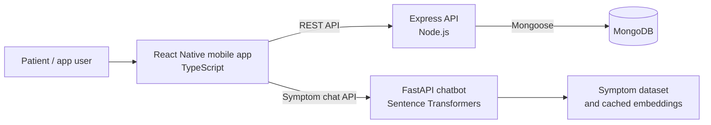

# SehatConnect

## Project Overview

SehatConnect is a React Native healthcare application backed by an Express and MongoDB API, with a separate FastAPI service for AI-assisted symptom queries. The repository contains the mobile client, backend services, and supporting setup and test scripts.

## Key Features

- Mobile app built with React Native and TypeScript for Android and iOS.
- Login and user profile features, including family-member and doctor information.
- Appointment booking and pharmacy search/order flows.
- Health metrics, prescriptions, and medicine reminder features.
- Emergency-service lookup and government health-scheme browsing.
- Chat conversations through the Node.js API and a separate symptom-chatbot service.
- English, Hindi, and Punjabi localization resources.

> The chatbot provides informational symptom matching, not medical diagnosis. Seek advice from a qualified healthcare professional.

## Screenshots

No application screenshots are currently included in this repository. Add verified screenshots here when they are available; the repository logo is not a screenshot of the running app.

## Architecture



The mobile app uses the Express service for general application data. The symptom-chat service is a separate Python service; it is not the same as the Express conversation endpoints.

## Technology Stack

- **Mobile:** React Native 0.81, React 19, TypeScript, React Navigation.
- **Main backend:** Node.js 20+, Express, Mongoose, MongoDB.
- **Symptom chatbot:** Python, FastAPI, Sentence Transformers, pandas, scikit-learn, and PyTorch (see `backend-chatbot/requirements.txt`).
- **Testing and tooling:** Jest, React Test Renderer, ESLint, npm.

## Setup and Installation

### Prerequisites

- Node.js 20 or newer and npm.
- MongoDB locally, or a MongoDB Atlas connection string.
- Python 3 and pip for the optional symptom-chatbot service.
- **Android:** Android Studio, Android SDK, JDK 17, and an emulator or device.
- **iOS:** macOS, Xcode, and CocoaPods.

### 1. Clone the repository

```bash
git clone https://github.com/kulwinderkour/SehatConnect.git
cd SehatConnect
```

### 2. Install mobile app dependencies

```bash
npm install
```

For iOS, install CocoaPods dependencies as well:

```bash
cd ios
bundle install
bundle exec pod install
cd ..
```

### 3. Configure and start the Express backend

In a second terminal:

```bash
cd backend
cp .env.example .env
```

Edit `backend/.env` and set `MONGODB_URI` to your local MongoDB or Atlas URI. The example also lists optional email, Cloudinary, JWT, and frontend-origin settings; use your own values where needed and do not commit credentials. By default, the API listens on port `5000`.

Install packages and start the service:

```bash
npm install
npm run dev
```

Use `npm start` for the non-watch start command. MongoDB must be reachable by the API. Confirm the service is responding at [http://localhost:5000/health](http://localhost:5000/health).

### 4. Start the symptom-chatbot service (optional)

In another terminal at the repository root:

```bash
cd backend-chatbot
python3 -m venv .venv
source .venv/bin/activate
python -m pip install -r requirements.txt
python chat_api.py
```

On Windows, activate the environment with `.venv\\Scripts\\activate` in Command Prompt or ` .venv\\Scripts\\Activate.ps1` in PowerShell (remove the leading space before the command).

The chatbot listens on port `8000`; its interactive API documentation is at [http://localhost:8000/docs](http://localhost:8000/docs). The service loads a Sentence Transformers model and symptom dataset during startup. The mobile chatbot service currently targets `localhost` on iOS Simulator and `10.0.2.2` on Android Emulator; a physical device needs a reachable host address configured in the app's chatbot service. The included `setup.sh` can assist with chatbot setup and dataset download on macOS/Linux.

### 5. Run the mobile app

Keep Metro running in a terminal at the repository root:

```bash
npm start
```

Then use another terminal to launch a configured emulator/device:

```bash
npm run android
# macOS with Xcode:
npm run ios
```

Local service URLs:

| Service | URL |
| --- | --- |
| Metro bundler | `http://localhost:8081` |
| Express API | `http://localhost:5000` |
| Express health check | `http://localhost:5000/health` |
| Symptom chatbot (optional) | `http://localhost:8000` |
| Chatbot API docs | `http://localhost:8000/docs` |

## Backend Implementation

The main backend entry point is `backend/server.js`. It loads environment settings, connects to MongoDB through Mongoose, and configures Express middleware for security headers, CORS, JSON parsing, compression, and request logging. It mounts route modules for authentication, users, appointments, pharmacies, health metrics, chatbot conversations, emergency services, schemes, reminders, prescriptions, and intake records. Controllers implement request handling and Mongoose models persist application data.

The separate `backend-chatbot/chat_api.py` service exposes a FastAPI interface. At startup it loads the `all-MiniLM-L6-v2` sentence-transformer model, the symptom dataset, and cached or newly built embeddings. It compares a submitted symptom message against the dataset and returns a text response with a confidence value. This is informational symptom matching, not clinical advice.

## API Endpoints

The main API base URL is `http://localhost:5000`. These routes are registered in the current backend code:

| Method | Path | Purpose |
| --- | --- | --- |
| `GET` | `/health` | Backend health status |
| `GET` | `/api` | API information and route groups |
| `POST` | `/api/auth/login` | Login |
| `GET` | `/api/auth/me` | Get current user |
| `POST` | `/api/auth/logout` | Logout |
| `GET`, `PUT` | `/api/users/profile` | Read or update profile |
| `GET`, `POST`, `PUT`, `DELETE` | `/api/users/family-members` and `/api/users/family-members/:id` | Manage family members |
| `GET` | `/api/users/doctors` and `/api/users/doctors/:id` | List or view doctors |
| `GET`, `POST`, `PUT` | `/api/appointments` and `/api/appointments/:id` | List, book, and update appointments; `PUT /:id/cancel` and `PUT /:id/complete` change appointment status |
| `GET`, `POST`, `PUT` | `/api/pharmacies` and pharmacy subpaths | Search/nearby pharmacies and manage orders; see `backend/routes/pharmacyRoutes.js` |
| `GET`, `POST` | `/api/health/metrics` | Read or add health metrics |
| `GET`, `POST`, `PUT`, `DELETE` | `/api/health/reminders` and `/api/health/reminders/:id` | Manage health reminders |
| `GET`, `POST`, `PUT` | `/api/chatbot/conversations` and conversation subpaths | Manage conversations, messages, and conversation status |
| `GET` | `/api/emergency` and `/api/emergency/nearby` | List or find nearby emergency services |
| `GET`, `PUT` | `/api/schemes` and scheme subpaths | Browse schemes and update bookmarks/application counts |
| Various | `/api/reminders`, `/api/prescriptions`, `/api/intake` | Medicine reminders, prescriptions, and intake records; see their route files for exact operations |

The independent symptom-chatbot API uses port `8000`:

| Method | Path | Purpose |
| --- | --- | --- |
| `GET` | `/` | Chatbot service information |
| `GET` | `/health` | Chatbot/model/dataset readiness status |
| `POST` | `/chat` | Submit a symptom message; returns a reply and confidence |
| `GET` | `/stats` | Dataset and model statistics |
| `GET` | `/docs` | Interactive FastAPI documentation |

## Testing

From the repository root, run the mobile Jest test and linter:

```bash
npm test
npm run lint
```

The backend package currently defines `npm test` as an explicit “no test specified” failure; it is not a backend test suite. For the chatbot's integration checks, start the chatbot service first, then in another terminal run:

```bash
cd backend-chatbot
python test_backend.py
```

The chatbot test script sends requests to `http://localhost:8000` and checks the service, health, chat, stats, and edge cases. **No test execution results are recorded here:** tests have not been run as part of this README update.

## Project Structure

```text
.
├── App.tsx                  # React Native app entry point
├── android/                 # Android project
├── ios/                     # iOS project
├── src/
│   ├── components/          # Reusable UI components
│   ├── contexts/ hooks/     # State and shared hooks
│   ├── i18n/                # Localization resources
│   ├── navigation/          # App navigation
│   ├── screens/             # App screens
│   ├── services/            # API and device services
│   ├── types/ utils/        # Types and helpers
│   └── assets/              # App assets
├── backend/
│   ├── config/ controllers/ middleware/
│   ├── models/ routes/ utils/
│   └── server.js            # Express API entry point
├── backend-chatbot/
│   ├── chat_api.py          # FastAPI chatbot entry point
│   ├── medical_chatbot.py   # Model and symptom matching logic
│   └── test_backend.py      # Chatbot API checks
└── __tests__/               # Mobile app tests
```

## Personal Contribution

The repository's available Git history attributes its listed commits to **@kulwinderkour**. The commit subjects include the initial project, authentication changes and fixes, reminder work, and cleanup. This summarizes the visible commit history; it does not claim individual authorship for every file or contribution beyond what that history establishes.

## License

The repository includes a `LICENSE` file; refer to it for the project's license terms.
